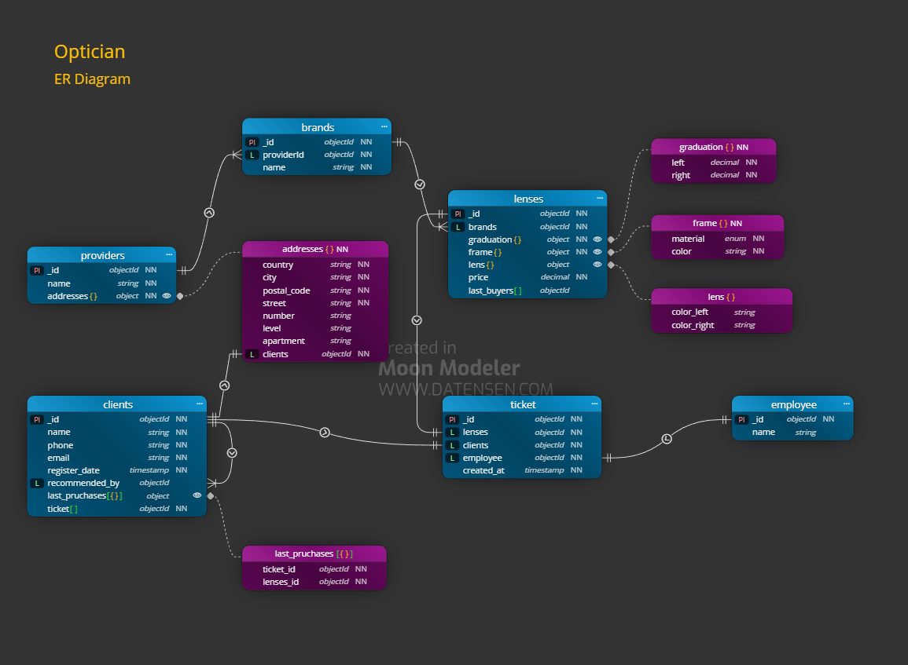

# task-mongodb-structures 

##  Enunciat de l'exercici Òptica

Una òptica, anomenada “Cul d'Ampolla”, vol informatitzar la gestió dels clients/es i vendes d'ulleres.

-   En primer lloc, l'òptica vol saber quin és el proveïdor de cadascuna de les ulleres. En concret vol saber de cada proveïdor: El nom, l'adreça (carrer, número, pis, porta, ciutat, codi postal i país), telèfon, fax, NIF.


-   De les ulleres es vol saber: La marca, la graduació de cadascun dels vidres, el tipus de muntura (flotant, pasta o metàl·lica), el color de la muntura, el color de cada vidre i el preu.


-   Dels clients/es vol emmagatzemar: El nom, l'adreça postal, el telèfon, el correu electrònic, la data de registre.
Quan arriba un/a client/a nou, emmagatzemar el/la client/a que li ha recomanat l'establiment (sempre que algú li hagi recomanat).
El nostre sistema haurà d’indicar qui ha sigut l’empleat/da que ha venut cada ullera. Defineix quin dia/hora es realitza la venda.

## 🛠 Tecnologies  
- mongodb -mongodb compass -moon modeler

## 🚀 Instal·lació i Execució
1. Clonar el repositori: `git clone ...`   
2. Visualitzar el diagrama
3. Variables d'entorn: Crear `.env` amb...  
-   MONGO_ROOT_USERNAME: mongodb_root
-   MONGO_ROOT_PASSWORD: _AAaaBBbb1122Root_
4. Per executar el mongodb container: `cd ... fins al nivell de directori corresponent del archiu 'compose.yml'`

    ```docker
    # Build the images
    docker compose build

    # Start the containers
    docker compose up -d

    # Check running containers
    docker compose ps

    # View logs
    docker compose logs -f

    # Stop the application
    docker compose down
    ```
5. Per executar el scripts mongodb de creació
    - mongosh shell (CLI):

        ```js
            // Connect to the mongodb shell (mongosh) and run
            // and enter MONGO_ROOT_PASSWORD when prompted
            mongosh "mongodb://MONGO_ROOT_USERNAME@localhost:27017/?authSource=admin" --password

            // Execute the script from inside the mongodb shell
            // Use '/' or '\\' directory delimiter instead of '\'.
            load('C:/Users/YourName/Desktop/create.js')

            load('C:\\Users\\YourName\\Desktop\\populate.js')

            // Change to desired database (eg: pizza)
            use pizza

            // To verify single collection and its validator
            db.getCollectionInfos({ name: "clients" }, true)

            // To verify all collections and its validators
            db.getCollectionInfos().forEach(c => {
                print("Collection: " + c.name);
                printjson(c.options?.validator);
            });
        ```

## 🧩 Diagrames i justificació de decisions tècniques

### Optician Entity Relationships


