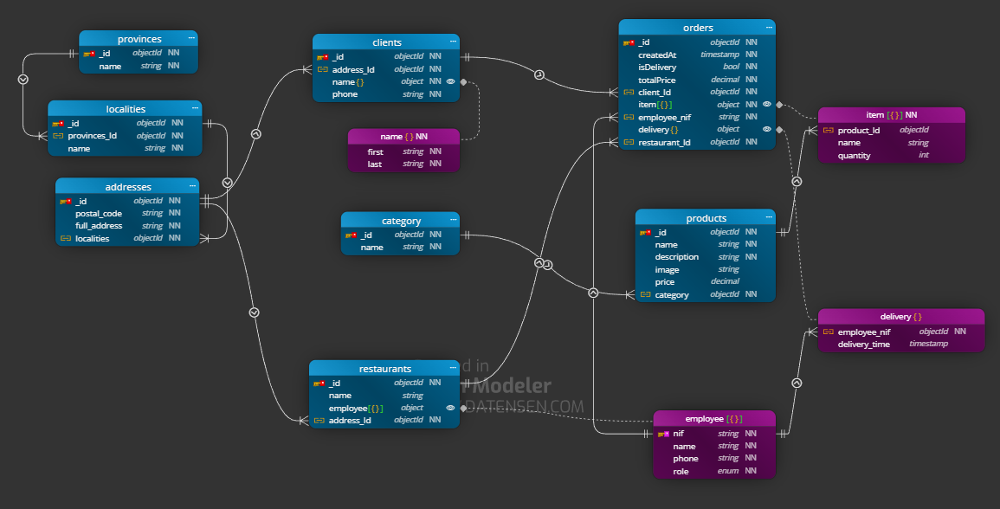

# task-mongodb-structures 

##  Enunciat de l'exercici Pizza

T’han contractat per a dissenyar una web que permeti fer comandes de menjar a domicili per Internet.

Tingues en compte les següents indicacions per a modelar com seria la base de dades del projecte:

-   Per a cada client/a emmagatzemem un identificador únic: Nom, cognoms, adreça, codi postal, localitat, província, número de telèfon.


-    Una persona pot realitzar moltes comandes, però una única comanda només pot ser realitzat per una única persona. De cada comanda s'emmagatzema un identificador únic: Data/hora de realització, si la comanda és per a repartiment a domicili o per a recollir en botiga, la quantitat de productes que s'han seleccionat de cada tipus, el preu total a més d’una nota amb informació addicional.


-    Una comanda pot constar d'un o diversos productes.

-   Els productes poden ser pizzes, hamburgueses i begudes. De cada producte s'emmagatzema un identificador únic: Nom, descripció, imatge, preu. En el cas de les pizzes existeixen diverses categories que poden anar canviant de nom al llarg de l'any.


-   Una comanda és gestionada per una única botiga i una botiga pot gestionar moltes comandes. De cada botiga s'emmagatzema un identificador únic: Adreça, codi postal, localitat, província.

-   En una botiga poden treballar molts empleats/des i un empleat/da només pot treballar en una botiga. De cada empleat/da, s'emmagatzema un identificador únic: Nom, cognoms, NIF, Telèfon, si treballa com a cuiner/a o repartidor/a. Per a les comandes de repartiment a domicili interessa guardar qui és el repartidor/a que fa el lliurament de la comanda i la data/hora del moment del lliurament.


## 🛠 Tecnologies  
- mongodb -mongodb compass -moon modeler

## 🚀 Instal·lació i Execució
1. Clonar el repositori: `git clone https://github.com/FeroXx07/task-mongodb-structures.git`   
2. Visualitzar el diagrama
3. Variables d'entorn: Crear `.env` amb...  
-   MONGO_ROOT_USERNAME: mongodb_root
-   MONGO_ROOT_PASSWORD: _AAaaBBbb1122Root_
4. Per executar el mongodb container: `cd ... fins al nivell de directori corresponent del archiu 'compose.yml'`

    ```docker
    # Build the images
    docker compose build

    # Start the containers
    docker compose up -d

    # Check running containers
    docker compose ps

    # View logs
    docker compose logs -f

    # Stop the application
    docker compose down
    ```
5. Per executar el scripts mongodb de creació
    - mongosh shell (CLI):

        ```js
            // Connect to the mongodb shell (mongosh) and run
            // and enter MONGO_ROOT_PASSWORD when prompted
            mongosh "mongodb://MONGO_ROOT_USERNAME@localhost:27017/?authSource=admin" --password

            // Execute the script from inside the mongodb shell
            // Use '/' or '\\' directory delimiter instead of '\'.
            load('C:/Users/YourName/Desktop/create.js')

            load('C:\\Users\\YourName\\Desktop\\populate.js')

            // Change to desired database (eg: pizza)
            use pizza

            // To verify single collection and its validator
            db.getCollectionInfos({ name: "clients" }, true)

            // To verify all collections and its validators
            db.getCollectionInfos().forEach(c => {
                print("Collection: " + c.name);
                printjson(c.options?.validator);
            });
        ```

## 🧩 Diagrames i justificació de decisions tècniques

### Pizza Entity Relationships


