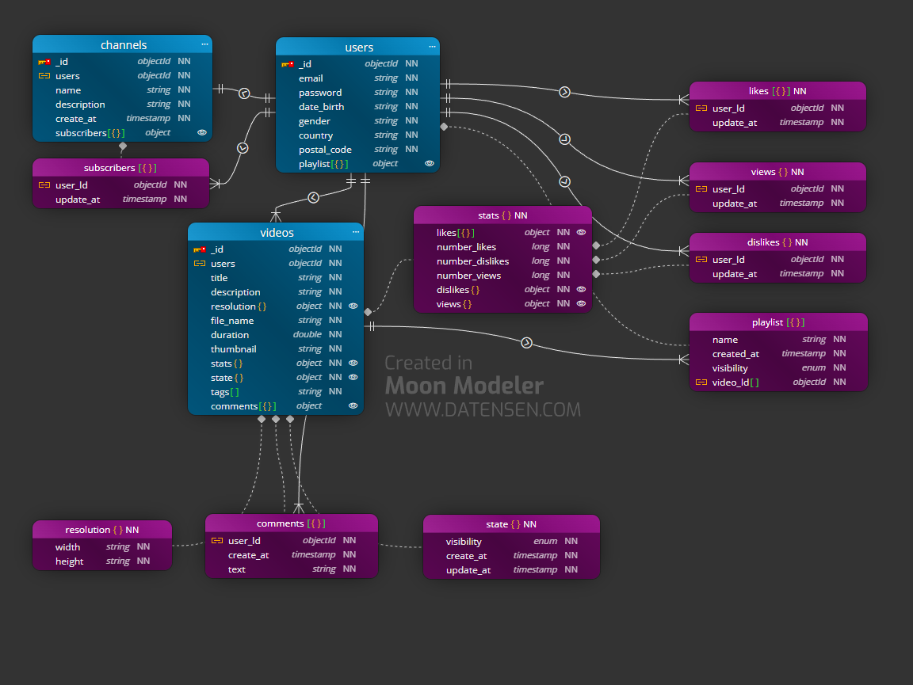

# task-mongodb-structures 

##  Enunciat de l'exercici YouTube

Tractarem de fer un model senzill de com seria la base de dades per a una versió reduïda de YouTube.

    De cada usuari/ària guardem un identificador únic: Email, password, nom d'usuari/ària, data de naixement, sexe, país, codi postal.


    Un usuari/ària publica vídeos. De cada vídeo guardem un identificador únic: Un títol, una descripció, una grandària, el nom de l'arxiu de vídeo, durada del vídeo, un thumbnail, el nombre de reproduccions, el número de likes, el número de dislikes.


    Un vídeo pot tenir tres estats diferents: públic, ocult i privat. Un vídeo pot tenir moltes etiquetes. Interessa guardar qui és l'usuari/ària que publica el vídeo i en quina data/hora el fa.


    Un usuari/ària pot crear un canal. Un canal té un identificador únic: Un nom, una descripció, una data de creació.


    Un usuari/ària es pot subscriure als canals d'altres usuaris/es. Un usuari/ària pot donar-li un like o un dislike a un vídeo una única vegada. Caldrà portar un registre dels usuaris/es que li han donat like i dislike a un determinat vídeo i en quina data/hora ho van fer.


    Un usuari/ària pot crear playlists amb els vídeos que li agraden. Cada playlist té un identificador únic: Un nom, una data de creació, un estat que indica que pot ser pública o privada.


    Un usuari/ària pot escriure comentaris en un vídeo determinat. Cada comentari està identificat per un identificador únic: El text del comentari, la data/hora en la qual es va realitzar.


## 🛠 Tecnologies  
- mongodb -mongodb compass -moon modeler

## 🚀 Instal·lació i Execució
1. Clonar el repositori: `git clone ...`   
2. Visualitzar el diagrama
3. Variables d'entorn: Crear `.env` amb...  
-   MONGO_ROOT_USERNAME: mongodb_root
-   MONGO_ROOT_PASSWORD: _AAaaBBbb1122Root_
4. Per executar el mongodb container: `cd ... fins al nivell de directori corresponent del archiu 'compose.yml'`

    ```docker
    # Build the images
    docker compose build

    # Start the containers
    docker compose up -d

    # Check running containers
    docker compose ps

    # View logs
    docker compose logs -f

    # Stop the application
    docker compose down
    ```
5. Per executar el scripts mongodb de creació
    - mongosh shell (CLI):

        ```js
            // Connect to the mongodb shell (mongosh) and run
            // and enter MONGO_ROOT_PASSWORD when prompted
            mongosh "mongodb://MONGO_ROOT_USERNAME@localhost:27017/?authSource=admin" --password

            // Execute the script from inside the mongodb shell
            // Use '/' or '\\' directory delimiter instead of '\'.
            load('C:/Users/YourName/Desktop/create.js')

            load('C:\\Users\\YourName\\Desktop\\populate.js')

            // Change to desired database (eg: pizza)
            use pizza

            // To verify single collection and its validator
            db.getCollectionInfos({ name: "clients" }, true)

            // To verify all collections and its validators
            db.getCollectionInfos().forEach(c => {
                print("Collection: " + c.name);
                printjson(c.options?.validator);
            });
        ```

## 🧩 Diagrames i justificació de decisions tècniques

### Youtube Entity Relationships


